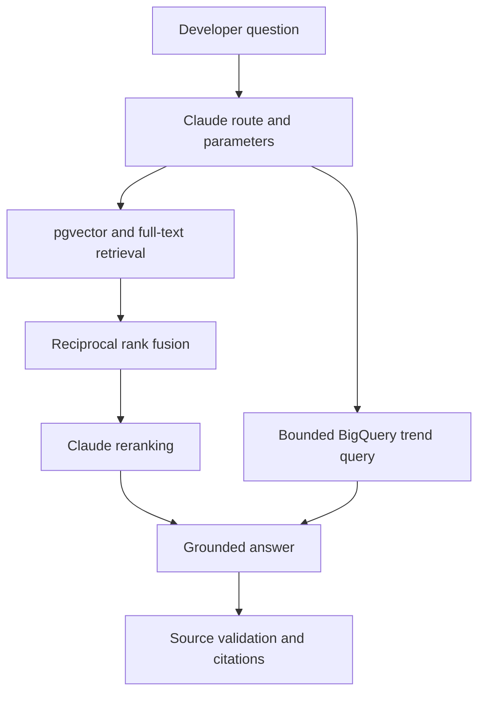

# Agentic RAG Developer Assistant

A developer Q&A service with two paths: retrieve accepted Stack Overflow answers, or query historical tag trends in BigQuery. LangGraph coordinates the steps; Claude handles planning, reranking and answer generation.

The project includes a small browser interface, FastAPI endpoints, PostgreSQL/pgvector schema, an ingestion job, a weekly Airflow DAG and an evaluation runner.

## Try it locally

Python 3.11 or 3.12:

```bash
python -m venv .venv
source .venv/bin/activate
pip install -e '.[test]'
uvicorn app.main:app --host 127.0.0.1 --port 8000
```

Open **http://127.0.0.1:8000**. Interactive API docs are at **/docs**.

Demo mode needs no keys. Try “How do I remove duplicates from a Python list?” or “How do I select the latest SQL row per group?” It uses five original fixtures and lexical ranking, clearly labeled in the response. It does not pretend to call Claude, search Stack Overflow or return live analytics.

```bash
curl http://127.0.0.1:8000/ask   -H 'Content-Type: application/json'   -d '{"question":"Why do Python mutable default arguments keep old values?"}'
pytest -q
```

## How the request flows



For retrieval, PostgreSQL returns semantic and keyword candidates. Reciprocal rank fusion combines their ranks; Claude selects up to six passages before generating the answer. Returned citation IDs must belong to those passages. That catches invented source IDs, but it does not prove every sentence is supported—faithfulness is evaluated separately.

For trends, Claude selects a tag and a time window. It never supplies executable SQL. The tool runs a fixed parameterized query for up to 36 complete calendar months, with a dry-run scan estimate and a maximum-bytes cap.

**“Queried now” is different from “current data.”** BigQuery public Stack Overflow tables can lag the website. Trend responses include dataset modification and query timestamps.

## Ingestion and storage

- Join questions to their accepted answers in the BigQuery public dataset.
- Strip HTML while retaining code blocks.
- Split text into 320-token chunks with 48-token overlap using the embedding model's tokenizer.
- Generate 384-dimensional BGE-small embeddings locally with FastEmbed.
- Store source URLs, author profile links, modification time and attribution metadata.
- Index vectors with HNSW and text with a GIN full-text index.
- Replace all chunks when an accepted answer changes; remove a question from the index when it no longer has an accepted answer.
- Commit each document and its incremental cursor in the same PostgreSQL transaction.

The refresh DAG runs Sundays at 03:00 UTC. Backfills should use zero overlap; regular refreshes use a 24-hour overlap. A PostgreSQL advisory lock prevents concurrent ingestion runs.

## Full setup

```bash
cp .env.example .env
docker compose up --build
```

Compose starts pgvector and the API on localhost. It defaults to demo mode.

For real retrieval, install the model extra, initialize the database and configure GCP application-default credentials:

```bash
pip install -e '.[models]'
# Set DATABASE_URL and GCP_PROJECT in the shell or secret manager.
python -m app.ingest --init-db --max-posts 1000 --overlap-hours 0
```

Set `APP_MODE=production`, a strong `API_KEY`, `ANTHROPIC_API_KEY`, `CLAUDE_MODEL`, `DATABASE_URL` and `GCP_PROJECT` before starting the API. Use the same embedding model for ingestion and queries.

See [deployment](docs/DEPLOYMENT.md) for permissions, model downloads, Docker credentials and rollout steps.

## Scale and evaluation status

**500K+ accepted Q&A documents is the intended corpus size, not a completed ingestion claim.** The extractor examines changed questions, including unaccepted ones. Continue backfill runs and check `SELECT count(*) FROM documents` to measure accepted pairs actually indexed.

`evaluation/candidates.jsonl` contains **200 draft questions across 50 intent groups**, with references and four phrasings per intent. These are not 200 independent, reviewed questions. Each row needs human review and matching accepted answer IDs before it becomes part of the golden set. Keep related phrasings in the same evaluation split.

The evaluation runner reports RAGAS faithfulness and LLM context recall, plus answer-ID recall@6 and MRR@6:

```bash
pip install -e '.[eval]'
python evaluation/validate_set.py evaluation/golden.jsonl --reviewed
python -m evaluation.run --dataset evaluation/golden.jsonl
```

No live RAGAS scores or 500K ingestion results are included. See [validation](docs/VALIDATION.md) for checks actually run.

## Tradeoffs

- Claude reranking is simple to inspect but adds a model call and latency. A local cross-encoder would be the next option to benchmark.
- HNSW trades index memory for retrieval speed. Changing the embedding model requires rebuilding the index; equal vector dimensions do not imply compatible embeddings.
- Source text is untrusted. The agent has no shell or arbitrary SQL tool, and instructions inside retrieved text are not part of its system prompt.
- Accepted answers can be wrong or outdated. The service can abstain, but citations and prompts alone cannot eliminate hallucinations.
- Weekly refresh is incremental, not a complete deletion audit. Hard-deleted questions and source changes outside the overlap need a periodic full reconciliation.
- The service uses a shared API key and four concurrent request slots. A public deployment needs TLS, user-level rate limits and spending controls.

## Layout

| Directory | Purpose |
|---|---|
| `app/` | FastAPI, LangGraph, retrieval and ingestion |
| `app/sql/` | Schema and bounded BigQuery queries |
| `airflow/` | Weekly refresh DAG |
| `evaluation/` | Candidate set, review validator and RAGAS runner |
| `tests/` | Unit/API tests and optional pgvector integration test |
| `docs/` | Setup, operations, validation and attribution |

Stack Overflow content is not bundled in this repository. [Attribution notes](docs/ATTRIBUTION.md) explain what the pipeline retains.
